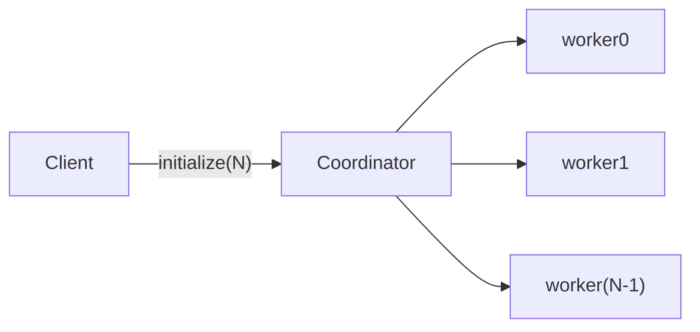
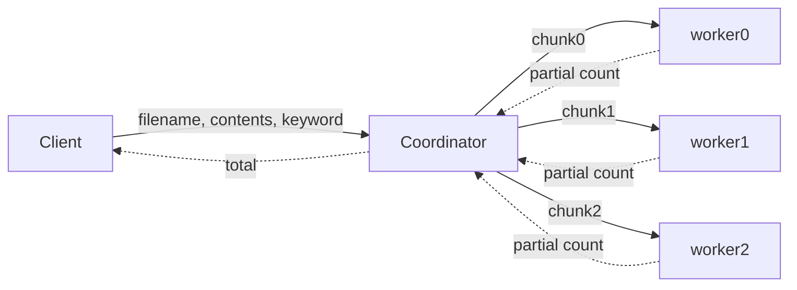
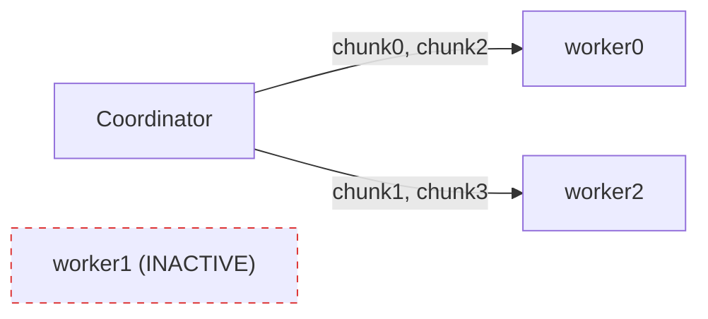

# CSCI.4430 Programming Languages, Fall 2026
## Programming Assignment #2: Distributed Log Analyzer using a Worker Pool

**Due Date:** Oct. 26 at 7:00 PM

This assignment is to be done either individually or in pairs. Do not show your code to any other group and do not look at any other group's code. Do not put your code in a public directory or otherwise make it public. However, you may get help from the mentors, TAs, or the instructor. You are encouraged to use the Submitty Discussion Forum so that other students can also answer and see the answers.

In this homework, you will implement a concurrent and distributed log analyzer using the actor model. The system consists of one Client, one Coordinator, and N Workers. For each analysis, the Coordinator divides a file into chunks, assigns the chunks to active Workers, and sums their keyword counts. Different analyses may execute at the same time.

Workers do not communicate with one another. The Coordinator stores their references, manages concurrent analyses, and records which Workers are active. A Worker can become permanently inactive; later analyses use only the Workers that remain active.

Implement the assignment in either **SALSA** or **Erlang**. First implement the concurrent version with every component in one local runtime. Then implement the distributed version with the Client and Coordinator together locally and the Workers on remote SALSA Theaters or Erlang nodes. The component behavior is the same in both versions.

---

## Program Initialization

The program is initialized once at startup. It receives four arguments:

```
<N> <script-file> <output-file> <locations-file>
```

- **N**: number of Workers. N is a positive integer (N ≥ 1).
- **script-file**: command script read by the Client.
- **output-file**: final result file containing one record for every Analyze command.
- **locations-file**: empty in concurrent mode; contains Theater or Erlang-node locations in distributed mode.

The Client creates one Coordinator. The Coordinator creates N Workers named `worker0` through `worker(N-1)`. All Workers are initially active. The Client must wait until the Coordinator and all Workers are ready before reading the first command.

The input script contains only Analyze and Inactive commands. There is no initialization command and no quit command. At end-of-file, the Client waits for all unfinished analyses to complete and then terminates.

You may assume that every command has the correct number of arguments, every named input file exists, every Worker ID is in the range 0 through N − 1, and every keyword is one valid word. Deactivating an already inactive Worker is also valid.

---

## Components and Command Ordering

### Client

The Client reads the script from top to bottom. Analyze commands do not wait for their final results; Inactive commands are barriers. The Coordinator must process the Client's requests in script order and dispatch each Analyze before processing the following request.

**Analyze**: Read the named file from the directory containing the script and send its filename, complete contents, keyword, and Client reference to the Coordinator. The Client may issue the following request without waiting for the final count. Language-specific ordering mechanisms must still preserve the script order described above.

```
a <FileName> <Keyword>
```

**Inactive**: Permanently deactivate the Worker with the given zero-based ID (ID starts from 0). The Client must wait for acknowledgement before reading the next command. This command produces no result record.

```
i <WorkerId>
```

For example, in the following script, `analysis1` may begin before `analysis0` finishes, but it must use the active-Worker set after `worker1` has been deactivated:

```
a demo1.txt hello
i 1
a demo2.txt world
```

The Inactive command does not cancel work already dispatched for an earlier analysis. Earlier chunks may still be running when deactivation is acknowledged and the next analysis begins, but every chunk dispatched before the barrier must still be completed and included in its original analysis.

The Client and Coordinator must run in the same local Theater for SALSA or on the same Erlang node for Erlang. Workers should run in different theaters during distributed mode.

### Coordinator

The Coordinator is responsible for the following tasks:

1. Create N Workers, store their references in Worker-ID order, and record which Workers are active.
2. Assign a zero-based analysis ID to every Analyze command in script order. The first is `analysis0`, the second is `analysis1`, and so on. Inactive commands do not receive an ID. An analysis that returns `ERROR` still uses its assigned ID.
3. For each Analyze command, take a snapshot of the active Workers, split the file into valid chunks, and assign a balanced amount of work to that snapshot.
4. Send all chunks asynchronously. Once they have been dispatched, allow the Client to continue without waiting for their partial counts.
5. Multiple Analyze commands may execute at the same time. The Coordinator must track each analysis independently. Every chunk request and partial-count reply must include both the analysis ID and chunk ID so that each reply is added to the correct analysis. After all chunks for one analysis have returned, sum only those partial counts and return exactly one final result for that analysis. Do not mix partial results from different analyses.
6. Process Inactive commands as barriers. Record the target Worker as inactive and obtain its acknowledgement before allowing the next script command. Do not cancel chunks already dispatched to that Worker. Repeated deactivation has no additional effect.

The Coordinator must remain able to accept a later Analyze or Inactive command while earlier analyses are still collecting partial results. A design that blocks the Coordinator until one complete analysis finishes is sequential and does not satisfy this assignment.

### Worker

Each Worker is responsible for the following tasks:

1. Maintain its Worker ID, name, and active state.
2. Save every assigned chunk in its own Worker directory using the required filename.
3. Count case-sensitive, exact-word matches and return the analysis ID, chunk ID, and partial count.
4. After an Inactive command, remain alive but permanently inactive. Complete every chunk assigned by an earlier analysis even if that chunk is processed after the deactivation message. The Worker process or actor is not terminated.

---

## Words and Chunks

Words are separated by one or more ASCII spaces, horizontal tabs, or line breaks. Punctuation and hyphens are part of a word. For example,

```
I love hello-world
```

contains the three words `I`, `love`, and `hello-world`. Matching is case-sensitive and requires the complete word. The keyword `hello` matches `hello`, but not `Hello`, `hello,`, `xhello`, or `hello-world`. Keywords may be any single word, such as `hello`, `world`, or `error-404`.

You can choose how to divide each input containing at least one word into chunks. Every division must satisfy all of the following rules:

- A chunk contains one or more complete words. A word cannot be split.
- Each chunk is a contiguous part of the input word sequence.
- Chunk IDs are consecutive, beginning with `chunk0`.
- Concatenating the chunks in chunk-ID order must reproduce the input word sequence exactly: no word may be added, removed, duplicated, or reordered.

An input containing no words produces no chunks. Its result is zero when at least one Worker is active. This includes an empty file or a file containing only spaces, tabs, or line breaks.

---

## Balanced Work Assignment

Each analysis uses the active-Worker snapshot taken when its Analyze command is processed. Let `L_i` be the total number of words assigned to active Worker `i` for that analysis, including all of its chunks. The assignment is valid only when

```
max(L_i) - min(L_i) <= 1
```

where Workers receiving no words have load zero. This rule applies across all active Workers, even when there are fewer words than Workers. A Worker may receive more than one chunk, and you may use any chunk boundaries and assignment strategy that satisfy the rule. Assigning all words to one Worker when the work could be shared is not valid.

If no Worker is active, the result is `ERROR` and no chunk file is created for that analysis. Deactivation changes only the active-Worker snapshots of later analyses; it never changes the chunks already assigned to an earlier analysis.

---

## Output Requirements

The automated file checks use only the final output file and the `workers` directory. Console and log output are not graded.

### Worker files

Initialization must create exactly N Worker directories:

```
workers/worker0/
...
workers/worker(N-1)/
```

Each assigned chunk must be saved in the directory of the Worker that receives it:

```
workers/worker<WorkerId>/analysis<AnalysisId>_chunk<ChunkId>.txt
```

For example, chunk2 of analysis0, assigned to worker1, is saved as:

```
workers/worker1/analysis0_chunk2.txt
```

A chunk file must contain at least one word. Its words must be separated by exactly one ASCII space, with no leading space, trailing space, or newline. A Worker that receives no chunk for an analysis creates no file for that analysis. One program run may execute multiple Analyze commands. Once a chunk file is created, it must remain in its Worker directory until that run terminates. Starting a new analysis must not delete or overwrite files from an earlier analysis.

The chunk files for one analysis may be stored in different Worker directories. For each analysis, concatenate chunk0, chunk1, and the remaining chunks in numeric chunk-ID order, placing one ASCII space between chunks. The resulting word sequence must be identical to the original input word sequence. Each chunk is stored by exactly one Worker, and the total number of words assigned to each active Worker must satisfy the balanced-load rule. No other files or directories may be created under `workers/`.

### Final output file

At startup, the Client creates an empty output file. When the Client receives an analysis result, it may append that result immediately. After every Analyze command has completed, the file must contain exactly one record per analysis. Records may appear in any order. Each record has one of these exact forms:

```
analysis<AnalysisId> <Count>
analysis<AnalysisId> ERROR
```

Use the lowercase word `analysis`, one ASCII space, and uppercase `ERROR`. Both `AnalysisId` and `Count` are canonical nonnegative decimal integers: only the value `0` may begin with zero. Every record ends with one ASCII LF (`\n`), with no blank or extra lines. For example:

```
analysis0 7
analysis1 ERROR
analysis2 3
```

Final results may arrive at the Client in any order. The Client does not need to buffer or reorder them; both completion order and increasing analysis-ID order are valid. Inactive commands do not add records.

---

## Actor Interaction Diagrams

### Figure 1: Initialization

The Client creates the Coordinator, and the Coordinator creates N Workers. No command is processed until every Worker is ready.



### Figure 2: One Analyze command

The Coordinator dispatches the chunks and later returns the analysis ID and total. Several instances of this flow may overlap.



### Figure 3: Inactive Worker

Inactive Workers receive no new chunks; the remaining Workers receive a balanced share. The arrows show one valid assignment.



---

## Directory / File Structure

The SALSA and Erlang starter codes are provided as separate packages. Use the directory structure for your selected language.

### SALSA starter

```
pa2/
├── LANGUAGE            (contains SALSA)
├── README.md
├── run_salsa.sh        (compiles and runs one test)
├── validate_test.py    (checks the generated output)
├── salsa1.1.6.jar      (SALSA compiler and runtime)
├── src/
│   ├── Client.salsa
│   ├── Coordinator.salsa
│   ├── Worker.salsa
│   └── FileUtility.java   (provided file and test utilities)
└── tests/
```

### Erlang starter

```
pa2/
├── LANGUAGE            (contains ERLANG)
├── README.md
├── run_erlang.sh       (compiles and runs one test)
├── validate_test.py    (checks the generated output)
├── src/
│   ├── client.erl
│   ├── coordinator.erl
│   ├── worker.erl
│   └── pa2_util.erl    (provided file and test utilities)
└── tests/
```

### Test directory

Both starters use the same test-directory structure:

```
tests/
└── testX/
    ├── input/
    │   ├── N.txt            (number of Workers)
    │   ├── test.script      (Analyze and Inactive commands)
    │   ├── theaters.txt     (SALSA Worker locations)
    │   ├── nodes.txt        (Erlang Worker locations)
    │   └── data files       (files named by Analyze commands)
    ├── expected/
    │   └── results/
    │       └── output.txt   (expected final results)
    └── output/              (created by the runner)
        ├── results/
        │   └── output.txt   (generated final results)
        └── workers/         (generated Worker chunk files)
            ├── worker0/
            │   └── analysis0_chunk0.txt
            ├── worker1/
            ├── ...
            └── worker(N-1)/
```

Each test's input files are stored with `test.script` in its `input/` directory. The supplied `N.txt` records the number of Workers used by that test; pass the same value as the first argument to the run script.

During a test, the runner creates temporary `results/`, `workers/`, and `logs/` directories at the assignment root. After the test finishes, it copies the result and Worker files into that test's `output/` directory. Running another test uses a different `output/` directory and does not overwrite the previous test's output. Rerunning the same test replaces that test's previous `output/`.

---

## Example Program Input and Output

Assume N = 3. The input files contain:

```
demo1.txt: hello red hello blue world hello
demo2.txt: world hello-world world green
```

One valid balanced division is:

```
analysis0 chunk0 = "hello red"        -> worker0
analysis0 chunk1 = "hello blue"       -> worker1
analysis0 chunk2 = "world hello"      -> worker2
analysis1 chunk0 = "world hello-world" -> worker0
analysis1 chunk1 = "world green"      -> worker2
```

The script is:

```
a demo1.txt hello
i 1
a demo2.txt world
```

The Coordinator dispatches analysis0, then processes the Inactive barrier. Once worker1 acknowledges deactivation, it dispatches analysis1 to worker0 and worker2 without waiting for every other analysis0 result. Thus analysis1 may finish first. Either of the following final outputs is valid:

```
analysis0 3
analysis1 2
```

or

```
analysis1 2
analysis0 3
```

The listed chunks are only one valid solution. A different set of chunk boundaries is correct if it preserves the word sequence, uses consecutive chunk IDs, and satisfies the balanced-load rule.

---

## SALSA Instructions

Use the supplied SALSA starter code. You may modify only `Client.salsa`, `Coordinator.salsa`, and `Worker.salsa`. Do not change their supplied method signatures. Do not modify `FileUtility.java`, `validate_test.py`, `run_salsa.sh`, or files under `tests`. `FileUtility.java` provides script reading, file I/O, Theater-file reading, word tokenization, and one optional balanced-chunk helper. You must implement actor creation, scheduling, result collection, and deactivation. You may use the helper or implement another valid chunking policy.

Run the supplied tests from the starter-code directory:

```bash
bash run_salsa.sh 3 tests/test1
bash run_salsa.sh 4 tests/test2
bash run_salsa.sh 12 tests/test3
bash run_salsa.sh 3 tests/test4
bash run_salsa.sh 5 tests/test5
```

The first argument is N; the second is the test directory. The runner compiles the program, starts the required SALSA services, runs the test, saves that test's output, and validates the result file and chunk invariants.

For concurrent execution, `theaters.txt` is empty. For distributed execution, it contains N + 1 nonempty lines:

- first line: Name Server `host:port`
- next N lines: Worker Theater `host:port`, in Worker-ID order

The Client creates the Coordinator locally. Worker UAN names must be `worker0`, `worker1`, and so on.

The supplied tests use concurrent mode for test1 through test3 and distributed mode for test4 and test5. The runner starts and stops the required SALSA services; you do not start them manually.

### SALSA Tips

- See the SALSA webpage and SALSA tutorial for actor creation, message passing, continuations, join blocks, UANs, UALs, and Theaters.
- Keep the supplied `module src;` declarations. A SALSA module name must match its directory path.
- SALSA messaging is asynchronous. Sending `m1(...); m2(...);` does not guarantee that `m1` finishes before `m2`.
- Use the continuation of an Analyze request only to confirm that its chunks were dispatched. Do not delay that continuation until the final count is available. Deliver the final result through a separate callback. Initialization and Inactive also require continuations because they are barriers.
- Named tokens may be passed as message arguments, but they may not be used in arbitrary expressions.
- Join results from different analyses may complete in any order. Preserve their analysis IDs and do not serialize the Client on the join.
- SALSA does not support generic types. Use `Vector` and type casts where necessary.

All remote SALSA Theaters or Erlang nodes must have access to the compiled code and the same assignment working directory.

---

## Erlang Instructions

Use the supplied Erlang starter code. You may modify only `client.erl`, `coordinator.erl`, and `worker.erl`. Do not change the supplied function signatures or modify `run_erlang.sh`, `pa2_util.erl`, `validate_test.py`, or files under `tests`.

The Client, Coordinator, and every Worker must run as separate Erlang processes and communicate by message passing. The supplied `pa2_util.erl` module provides file I/O, word tokenization, Worker-node management, and an optional balanced-chunk helper.

Run the supplied tests from the starter-code directory:

```bash
bash run_erlang.sh 3 tests/test1
bash run_erlang.sh 4 tests/test2
bash run_erlang.sh 12 tests/test3
bash run_erlang.sh 3 tests/test4
bash run_erlang.sh 5 tests/test5
```

The first argument is N, which must match the value in the test's `N.txt`. The second argument is the test directory. The runner compiles the Erlang files, starts the required Erlang nodes, runs the Client, saves the generated files in the test's `output/` directory, and runs the supplied validator.

The same runner is used for both execution modes:

- **Concurrent mode:** `nodes.txt` is empty. The Client, Coordinator, and Workers run as separate Erlang processes on the controller node.
- **Distributed mode:** `nodes.txt` contains exactly N nonempty lines. Each line gives the Erlang node for one Worker, in Worker-ID order. The Client and Coordinator remain on the controller node.

The supplied tests use concurrent mode for test1 through test3 and distributed mode for test4 and test5. The runner starts and stops the required Erlang nodes; you do not start them manually.

For example, when N = 3, a distributed `nodes.txt` may contain:

```
pa2_worker0@hostA
pa2_worker1@hostB
pa2_worker2@hostC
```

The first nonempty line is used for worker0, the second for worker1, and so on. All node names must use the `name@host` format. All nodes must use the same Erlang cookie and naming mode.

### Erlang Tips

- See the Erlang documentation on processes and message passing and distributed Erlang.
- Implement the Client, Coordinator, and Workers as recursive `receive` loops. Pass updated state to the next loop call.
- Do not collect all partial counts inside a blocking Coordinator `receive` loop. Track concurrent analysis states or create a separate collector process so the Coordinator can accept later commands.
- Erlang messages are asynchronous. Include the analysis ID and chunk ID in every work request and partial result.
- Acknowledge an Inactive command before the Client reads the next command. Deactivation changes state; it does not terminate the Worker process or its Erlang node.

All remote SALSA Theaters or Erlang nodes must have access to the compiled code and the same assignment working directory.

---

## Due Date and Submission Guidelines

**Due Date:** Oct. 26 at 7:00 PM

**Grading:** Grading will consider the correctness of the generated output, concurrent execution, distributed Worker placement, and source-code clarity.

**Submission Requirements:** Submit exactly one SALSA or Erlang implementation. Your submission must contain:

- A file named `LANGUAGE` containing exactly one line: `SALSA` or `ERLANG`.
- A `README.md` listing all group members, implemented features, and known bugs.
- For SALSA: `src/Client.salsa`, `src/Coordinator.salsa`, and `src/Worker.salsa`.
- For Erlang: `src/client.erl`, `src/coordinator.erl`, and `src/worker.erl`.
- Preserve these paths, compress the required files into one `.zip` file, and upload it to Submitty.

Do **not** submit the supplied run scripts, utility files, validator, SALSA jar, generated Java files, compiled files, log files, test output, or the `workers` directory.